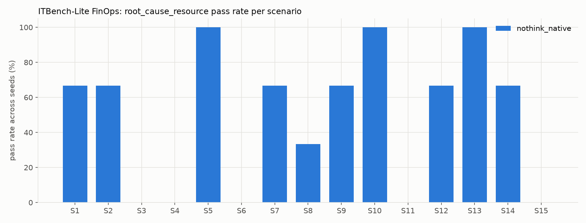
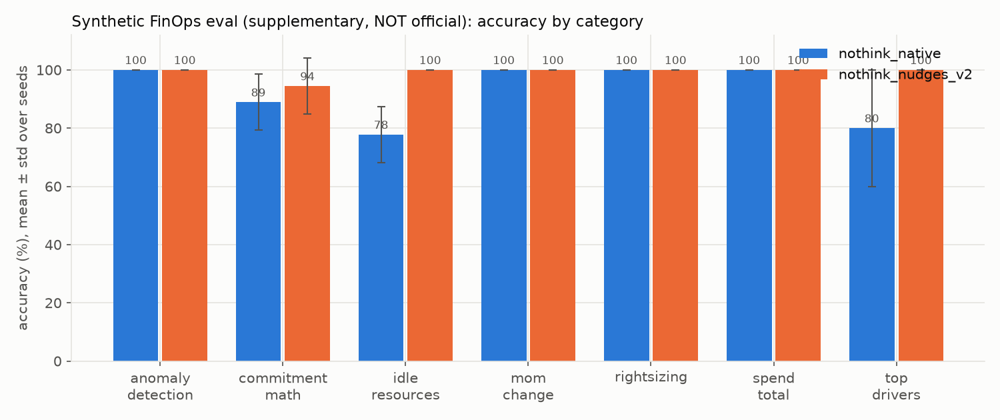
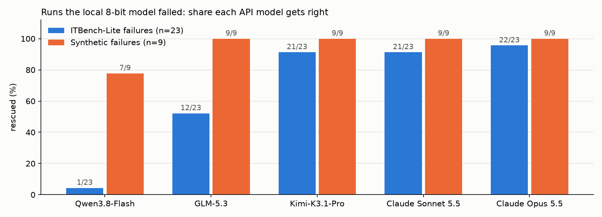
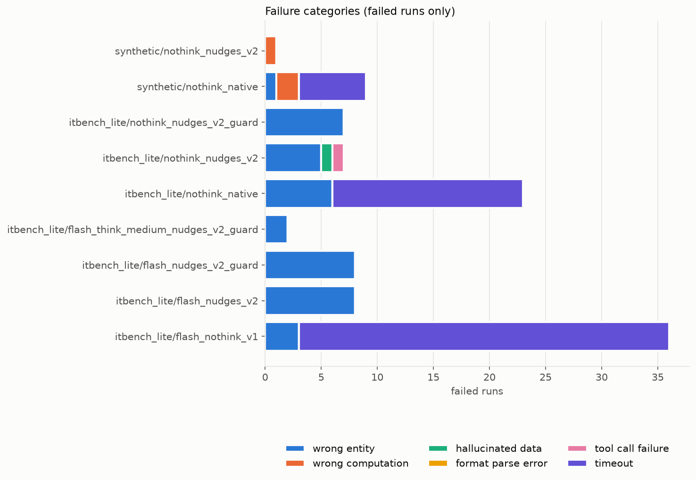
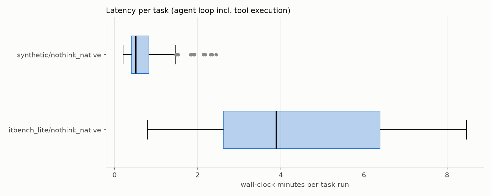

# Qwen3.8-27B (MLX 8-bit) — FinOps Evaluation Report

> **Living report**: updated after every phase. Status of each phase is at the top; sections fill in as results land.
> Every number here comes from a run whose raw output is saved under `~/finops-eval/` (paths given inline).

## Status

| Phase | Status | Notes |
|---|---|---|
| 0. Preflight | ✅ done | M5 Max, 64 GiB, 1.7 TiB free → 8-bit (no 4-bit fallback) |
| 1. Download BF16 | ✅ done | 55.6 GB in 1h46m; 18/18 shards SHA-256 verified |
| 2. Quantize to 8-bit | ✅ done | affine 8-bit g64 → 27 GB, 8.501 bpw; sanity 2/3 (arithmetic failed) |
| 3. Local server | ✅ done | mlx_lm.server 127.0.0.1:8080; native tool calls OK; sleep-stall bug fixed with caffeinate |
| 4.1 ITBench-Lite FinOps | 🟡 baseline done; follow-up running | non-thinking baseline: **48.9% ± 3.8%** (22/45 runs). Thinking run stopped at 5/45 (DECISIONS #18) |
| 4.1b Follow-up: budget nudges + prompt v2 | ⏸ stopped by user | A stopped at 10/45 runs; B and C not started (DECISIONS #21) |
| 4.1c Failed runs on Together Qwen3.8-Flash | ✅ done | ITBench-Lite 1/23 rescued, synthetic 7/9 rescued; cost ≈ $0.74 (DECISIONS #23) |
| — Qwen3.8-2.4T-A95B-FP8 | ⛔ unavailable | not servable on Together (DECISIONS #22) |
| 4.1d Failed runs on GLM-5.3 / Kimi-K3.1-Pro / Claude Opus 5.5 / Sonnet 5.5 | ✅ done (resumed) | ITBench-Lite rescued: **Opus 5.5 22/23**, Sonnet 5.5 21/23, Kimi 21/23, GLM 12/23; synthetic 9/9 for all four. Claude cost $2.07 (Opus) / $1.03 (Sonnet). Mistral 4 not available (DECISIONS #24–25, #31) |
| 4.1e Harness improvements (nudges, prompt v2, repeat guard, thinking effort) | ✅ done | **Flash: 20.0% → 82.2%** (nudges + v2) **→ 95.6%** (+ thinking-medium). **27B: 48.9% → 84.4%** (nudges + v2; decision rule passed) **→ 100%** (+ thinking-medium; strict set match 60%). Post-tuning. Synthetic nudges + v2: 93.0% → 99.2%. Guard alone: no change (84.4%). All runs complete (DECISIONS #26–30) |
| 4.2 Full ITBench FinOps | ⛔ skipped | needs Kubernetes + container runtime (see Skipped) |
| 4.3 aws-bench | ⛔ skipped (by design) | provisions real AWS; review only |
| 4.4 Synthetic FinOps eval | ✅ done | 43 tasks × 3 seeds: **93.0% ± 2.3%** (120/129); post-tuning nudges + v2: **99.2%** (128/129) |
| 5. Analysis | ✅ done (updates as runs finish) | Error analysis §4, recommendations §9 |

## 1. Setup

- **Hardware**: Apple M5 Max, 64 GiB unified memory (68,719,476,736 bytes), macOS 26.5.1 (25F80), 1.7 TiB free disk.
- **Model source**: `Qwen/Qwen3.8-27B` (HF revision `8c0b3d30f3ae96f5c7f774de704bf0ada83e422a`), BF16, 27.78 B params, arch `Qwen3_5ForConditionalGeneration` (`model_type: qwen3_5`, image-text-to-text).
- **Quantization**: MLX affine 8-bit, group size 64 (`--q-bits 8 --q-group-size 64 --q-mode affine`), via `mlx_lm.convert` 0.32.2, from the verified BF16 weights. Output 27 GB, **8.501 bits/weight** effective (8-bit codes + fp16 scale/bias per 64-weight group). Text decoder only; vision tower dropped (all benchmarks are text). Path: `models/qwen3.8-27b-mlx-8bit`.
- **Download verification**: 18/18 shards match Hub LFS SHA-256 and size. The repo's `crc32.txt` (which covers only 8 config/tokenizer files) is stale for 3 of them: the local copies are byte-identical to the Hub blobs (see DECISIONS #14).
- **Software**: mlx 0.32.4, mlx-lm 0.32.2, mlx-vlm 0.7.12, transformers 5.22.1 (full lock: `requirements.lock`).
- **Sampling (model card, non-thinking/instruct)**: temperature 0.7, top_p 0.8, top_k 20, min_p 0, presence_penalty 1.5, repetition_penalty 1.0.
- **Sampling (model card, thinking)**: temperature 1.0, top_p 0.95, top_k 20, min_p 0, presence_penalty 0.
- **Thinking mode**: off by default (`chat_template_kwargs: {"enable_thinking": false}`).

## 2a. Sanity check (Phase 2), 8-bit, non-thinking, in-process mlx-lm

Raw output: `results/sanity/sanity_perf_8bit.json`.

| Prompt | Output (truncated) | Pass | Prefill tok/s | Decode tok/s | Peak mem |
|---|---|---|---|---|---|
| Arithmetic 1234×56−789 (=68,315) | `67542` | ❌ | 10.8* | 22.19 | 28.856 GB |
| "What is a reserved instance" | A reserved instance is a billing model that allows organizations to commit to using a spec… | ✅ | 107.51 | 18.41 | 28.865 GB |
| Strict JSON object | `{   "service": "EC2",   "monthly_cost": 1234.5,   "tags": [ ` | ✅ | 254.32 | 18.54 | 28.913 GB |

\* first call includes Metal kernel warm-up; prompt only 30 tokens.

Long-prompt prefill probe (same run): 5,530 tokens → 841.23 tok/s prefill, peak 31.71 GB; 55,030 tokens → 597.37 tok/s prefill, peak 34.991 GB; 220,030 tokens → 263.02 tok/s prefill, peak 54.802 GB.

**Tool calling (Phase 3)**: `mlx_lm.server` parsed the model's XML tool calls into OpenAI `tool_calls` correctly (healthcheck: `results/sanity/healthcheck.json`). All benchmark results use the **native** protocol; the ReAct text fallback was implemented but not needed. Thinking mode returns reasoning in a separate `reasoning` field.

## 2. Results

### 2.1 ITBench-Lite FinOps (official metric), 15 scenarios × 3 seeds

Raw output: `results/itbench_lite/nothink_native/` (`<Scenario>/seed_<s>/trajectory.json`, `scores.jsonl`, `summary.json`). Scoring follows the official ITBench-Evaluations FinOps rubric (`root_cause_resource`: every ground-truth resource must be matched by name **and** type). I applied it deterministically, without an LLM judge (DECISIONS #7). Agent: native tool calling with one `run_python` tool, at most 20 steps, non-thinking, model-card sampling.

| Config | root_cause_resource (official) | n | Pass / fail | Strict set match | Name-only match | F1 (name,type) | Answered (parsed) |
|---|---|---|---|---|---|---|---|
| **8-bit, non-thinking** | **48.9% ± 3.8%** (per seed 46.7 / 46.7 / 53.3) | 45 runs (15 × 3) | 22 / 23 | 35.6% ± 7.7% | 48.9% ± 3.8% | 0.444 ± 0.000† | 28 / 45 |
| 8-bit, thinking (xhigh, original harness) | *stopped on user instruction, not scored* (DECISIONS #18); thinking with the improved harness is in section 2.5: **100%** | | | | | | |
| *Non-LLM heuristic (reference)* | *60.0%* (top instance family by cost delta) | 15 | 9 / 6 | | | | |
| *Non-LLM heuristic, auto-dimension* | *46.7%* | 15 | 7 / 8 | 46.7% | | 0.526 | |

± is the std across the 3 seed-level accuracies. † F1 is averaged per seed, then the std is taken across seeds. The zero std is a coincidence, not a bug: every seed's F1 sums to 6.667/15 (DECISIONS #20). The heuristic baselines are `results/itbench_lite/_heuristic_baseline/` (`scripts/itbench_heuristic_baseline.py`). They are a sanity reference for task difficulty, **not** an agent result.

**What the numbers mean**
- **The step budget is the main failure.** 17 of 45 runs (38%) used all 20 steps and never gave an answer. Of the 28 runs that did answer, **22 were correct (78.6%)**. The model can usually find the root cause but often fails to commit to it. It keeps re-running near-identical pandas analyses (e.g. `Scenario-4/seed_2`: steps 7–18 are variations of one group-by/delta script, and step 19 says "The root cause is clear. Let me verify…" before the budget runs out).
- **Wrong dimension.** All 6 answered-but-wrong runs picked the wrong *column*. S6 (20 Application root causes) got Instance Families twice. S3 (one Application root cause) got Instance Families. S1 and S7 got an Application where the answer was an Instance Family. S8 got Cloud Services.
- **Over-inclusion** (passes the official metric but not strict set match): 6 runs listed an extra resource. S5 did this in all 3 seeds.
- **Per scenario** (pass rate across seeds): S5, S10 and S13 are 3/3. S3, S4, S6, S11 and S15 are 0/3. S4, S11 and S15 failed only by step-cap timeouts. S3 and S6 mix timeouts with wrong-dimension answers: these are the two scenarios whose root cause is an Application.

### 2.2 Synthetic FinOps eval (supplementary, NOT an official benchmark)

This is my own benchmark, generated by `scripts/gen_synthetic.py` (seed 20261106, ground-truth sha256[:16] `6f909dfab764aed0`). It has 43 tasks over FOCUS-format billing exports, inventories and pure commitment arithmetic. Scoring is exact match or numeric tolerance per field, and a task passes only if every field matches. Same agent and sampling as 2.1 (non-thinking). Raw output: `results/synthetic/nothink_native/`.

**Overall: 93.0% ± 2.3%** (per seed 93.0 / 90.7 / 95.3). n = 129 runs (43 × 3): 120 pass, 9 fail. Mean 42 s/run.

| Category | Tasks | Accuracy (mean ± std over seeds) | Pass / runs |
|---|---|---|---|
| spend_total | 8 | 100% ± 0 | 24 / 24 |
| mom_change | 6 | 100% ± 0 | 18 / 18 |
| rightsizing | 6 | 100% ± 0 | 18 / 18 |
| anomaly_detection | 6 | 100% ± 0 | 18 / 18 |
| commitment_math | 6 | 88.9% ± 9.6% | 16 / 18 |
| top_drivers | 5 | 80.0% ± 20.0% | 12 / 15 |
| idle_resources | 6 | 77.8% ± 9.6% | 14 / 18 |

Failures:
- **6 step-cap timeouts.** Two each on idle_03, idle_05 and top_drivers (01, 02). idle_05's correct answer is an *empty list*, and the model kept searching rather than conclude that nothing qualifies.
- **2 wrong computations.** commit_04: Savings-Plan overflow pricing, answered 80.88 instead of 81.22. commit_06: answered 20 RIs / $905.20 instead of 12 RIs / $8,342.44. $905.20 = 20 × $0.062 × 730 h is one *month* of RI cost, so it mixed monthly and yearly figures and chose the wrong RI count.
- **1 wrong entity.** top_drivers_04 seed 2 returned the pandas row index `"5"` as the ResourceId. The increase it reported was correct.

The synthetic anomaly tasks give the date, account and service of a single injected spike, and they are much easier than ITBench-Lite. The model scored 100% on them but 48.9% on ITBench-Lite. **This number must not be compared with the ITBench scores.** It shows the model's arithmetic and pandas skills are sound when the task is tightly specified.

**Post-tuning: nudges + prompt v2** (`results/synthetic/nothink_nudges_v2/`; same 43 tasks × 3 seeds, non-thinking). On synthetic tasks v2 changes only the system prompt (budget discipline, "an empty result is a valid answer"); the ITBench method block is not used. That sentence was written after the idle_05 failure, so this is post-tuning too.

**Overall: 99.2% ± 1.3%** (per seed 100 / 100 / 97.7; 128/129; Wilson 95.7–99.9%), up from 93.0%. All 129 runs answered, with no step-cap failures. 15 runs reached the forced final and **all 15 were correct**. Mean steps went from 5.5 to 8.1 and mean wall time from 42 s to 69 s.

| Category | Baseline (v1) | Nudges + v2 |
|---|---|---|
| idle_resources | 77.8% | **100%** (idle_05, the empty-list case, now passes in all seeds) |
| top_drivers | 80.0% | **100%** |
| commitment_math | 88.9% | 94.4% |
| spend_total, mom_change, rightsizing, anomaly_detection | 100% | 100% |

The only failure left is **commit_06 seed 3**. It gives the same wrong answer as the baseline (20 RIs / $905.20, mixing monthly and yearly cost), so it is a reasoning error the harness cannot fix. As on ITBench, every gain came from step-cap failures turning into answers.

### 2.3 Failed runs re-run on Together `Qwen/Qwen3.8-Flash` (user-approved paid API run)

The user asked for the failed benchmarks on `Qwen/Qwen3.8-2.4T-A95B-FP8`. Together does not serve that model: it has no serverless access and no dedicated-endpoint hardware (DECISIONS #22). The user then chose `Qwen/Qwen3.8-Flash`. Only the (item, seed) runs that the local 8-bit baseline **failed** were re-run, with identical agent, prompt (v1), sampling, non-thinking mode, 20-step cap and seeds (DECISIONS #23). Raw output: `results/{itbench_lite,synthetic}/flash_failedruns/`. The pair lists are `results/*/failed_pairs_nothink_native.txt`.

**These are rescue rates on the hardest subset, not benchmark scores, and they are not comparable to 48.9% or 93.0%.**

| Subset | Runs | Rescued (pass) | Answered | Hit 20-step cap | Mean steps | Mean wall/run | Tokens in / out | Est. cost† |
|---|---|---|---|---|---|---|---|---|
| ITBench-Lite baseline failures | 23 | **1 / 23** (S1 seed 2) | 2 | 21 | 19.3 | 75 s | 4,397,260 / 89,526 | $0.70 |
| Synthetic baseline failures | 9 | **7 / 9** | 7 | 2 (idle_05, both seeds) | 7.8 | 16 s | 208,182 / 6,767 | $0.03 |

† Token counts from the API `usage` field × Together list price ($0.15/M input, $0.47/M output). This is an estimate, not an invoice.

**Findings**
- **The step-cap failure is not specific to the local 8-bit model.** Flash hit the 20-step cap on 21 of 23 ITBench-Lite failures. It shows the same behaviour: it keeps re-verifying after finding the signal. In `Scenario-3/seed_1` it inspects d7I, the true root-cause Application, early and still never answers. Its only other answer, S6 seed 3, listed **125 Instance Families** (wrong dimension; ground truth is 20 Applications). Together with the smoke run in §2.1, this points to the harness and prompt (no budget awareness, no forcing of a final answer) as the main cause of the ITBench-Lite gap, more than 8-bit quantization or model size. The interrupted follow-up (budget nudges + prompt v2) was designed to test exactly this.
- **Synthetic: Flash fixed 7 of 9.** It answered both commitment-math errors (commit_04, commit_06), both idle_03 timeouts, the top_drivers timeouts and the row-index entity error (top_drivers_04). It failed idle_05 in both seeds, again by searching for 20 steps when the correct answer is an empty list.
- Flash is about 3.5× faster per ITBench-Lite run than the local 8-bit model (75 s vs 261 s), at about 3 cents per run.

**Other models on the same failed runs** (DECISIONS #24–25; provider-default sampling, thinking off; otherwise identical harness). Mistral 4 is not served on Together and there is no Mistral key. **Claude Opus 5.5 and Sonnet 5.5** were added later through the Anthropic API (DECISIONS #31). They use the same harness, but with **thinking on**: Opus 5.5 cannot turn it off, and both run adaptive thinking at effort `medium`. Raw output: `results/*/glm53_failedruns/`, `results/*/kimik31_failedruns/`, `results/*/opus55_failedruns/`, `results/*/sonnet55_failedruns/`. Comparison: `results/analysis/failedruns_compare.json`.

| Model (provider) | ITBench-Lite rescued (n=23) | Answered | Step cap | Wrong dimension | Synthetic rescued (n=9) | Mean steps (ITB) | Mean wall (ITB) | Est. cost† |
|---|---|---|---|---|---|---|---|---|
| Qwen3.8-Flash | 1 | 2 | 21 | 1 | 7 | 19.3 | 75 s | $0.74 |
| GLM-5.3 | 12 | 12 | 2 | 0 | **9** | 11.6 | 114 s | $5.95 |
| **Kimi-K3.1-Pro** (Together) | **21** | 22 | 1 | 0 | **9** | 9.7 | 88 s | $4.79 |
| **Claude Sonnet 5.5** (Anthropic, thinking medium) | **21** | 23 | 0 | 1 | **9** | 8.8 | **22 s** | **$1.03**‡ |
| **Claude Opus 5.5** (Anthropic, thinking medium) | **22** | 23 | 0 | 0 | **9** | **7.4** | 25 s | $2.07‡ |

- **Kimi-K3.1-Pro rescues almost every ITBench-Lite failure** (21/23; it missed only S8 seed 1 and S11 seed 1), in about 10 steps, with no wrong-dimension answers. It also solves both Application-dimension scenarios (S3 and S6) in every seed where the local model failed them. A stronger model therefore *does* finish within the same 20-step harness. The step cap stops weaker models; it is not an impossible budget.
- GLM-5.3 rescues about half (12/23). It still misses all three S6 seeds (20 Application root causes) and several S8 and S11 seeds.
- Both GLM and Kimi fixed all 9 synthetic failures, including idle_05 (correct answer: empty list).
- **Claude Opus 5.5 rescues the most: 22 of 23 ITBench-Lite failures plus 9 of 9 synthetic.** Every run answered, none hit the step cap and none refused. It took the fewest steps of any model (7.4), and it solved all three S6 seeds (20 Application root causes) and all three S11 seeds, which Kimi partly missed. Its only miss was S8 seed 2: it answered Instance Family `QI78eHTqNo` instead of `W4ugKNiEYE`.
- **Claude Sonnet 5.5 ties Kimi (21/23, 9/9) at about a fifth of the cost and a quarter of the wall time.** It missed S8 seed 1, with the same wrong `QI78eHTqNo` answer as Opus, and S6 seed 1, where it listed Instance Families instead of the 20 Applications. S8 is the scenario every strong model misses at least once, so its ground truth is worth a manual check.
- **Cost**: the 32 runs cost **$2.07 (Opus)** and **$1.03 (Sonnet)**, against $4.79 for Kimi and $5.95 for GLM, despite similar or higher list prices. Two things explain it: prompt caching (77–82% of Claude's input tokens were cache reads, billed at $0.20/M) and shorter runs.
- **Caveat: this is not a like-for-like model ranking.** The Claude models think and the Together models did not, and these are rescue rates on the 32 hardest runs, not benchmark scores. The comparable full-benchmark numbers would need the 45 + 129 runs (not done; DECISIONS #31).

‡ Exact sum of per-call costs recorded in each trajectory: API usage (uncached input, cache writes, cache reads, output including thinking tokens) × Anthropic list price (Opus 5.5 $4 / $20 / $5 / $0.20 per M; Sonnet 5.5 $2 / $10 / $2.50 / $0.20 per M). This is an estimate, not an invoice. Smoke tests added about $0.01.

### 2.6 All models and harnesses on the same 32 hard runs (no new runs)

This table compares every model and harness on the **same 32 runs**: the 23 ITBench-Lite and 9 synthetic runs that the local 27B baseline failed. It is built only from results already on disk (`scripts/compare_all_subset.py` → `results/analysis/all_models_compare.json`). Configs that were run on the full benchmark are cut down to those 32 pairs. The last column gives the full-benchmark score where one exists.

| Model | Thinking | Harness | ITBench-Lite hard runs solved (of 23, official) | **Exact answers (of 23)** | Synthetic hard runs solved (of 9) | Mean steps (ITB) | Mean wall/run (ITB) | Cost, 23 ITB runs | Cost per solved run | Full ITBench-Lite official (45 runs) | **Full ITBench-Lite exact** |
|---|---|---|---|---|---|---|---|---|---|---|---|
| Qwen3.8-27B (local 8-bit) | off | original (v1) | 0 *(by construction)* | 0 | 0 *(by construction)* | 17.8 | 350 s | $0 | n/a (0 solved) | 48.9% | 35.6% |
| Qwen3.8-27B (local 8-bit) | off | nudges + v2 | 18 | 10 | 8 | 13.7 | 397 s | $0 | $0 | 84.4% | 35.6% |
| Qwen3.8-27B (local 8-bit) | off | nudges + v2 + guard | 19 | 10 | — | 13.3 | 277 s | $0 | $0 | 84.4% | 40.0% |
| **Qwen3.8-27B (local 8-bit)** | **medium** | nudges + v2 + guard | **23** | 17 | — | 8.7 | 513 s | $0 | $0 | **100%** | 60.0% |
| Qwen3.8-Flash (Together) | off | original (v1) | 1 | 1 | 7 | 19.3 | 75 s | $0.70 | $0.700 | 20.0% | 20.0% |
| Qwen3.8-Flash (Together) | off | nudges + v2 | 17 | 12 | — | 16.9 | 68 s | $0.74 | $0.044 | 82.2% | 62.2% |
| Qwen3.8-Flash (Together) | off | nudges + v2 + guard | 18 | 9 | — | 18.6 | 75 s | $0.94 | $0.052 | 82.2% | 46.7% |
| **Qwen3.8-Flash (Together)** | **medium** | nudges + v2 + guard | **22** | **22** | — | 8.7 | 75 s | **$0.38** | **$0.017** | **95.6%** | **93.3%** |
| GLM-5.3 (Together) | off | original (v1) | 12 | 12 | 9 | 11.6 | 114 s | $5.82 | $0.485 | — | — |
| Kimi-K3.1-Pro (Together) | off | original (v1) | 21 | 19 | 9 | 9.7 | 88 s | $4.67 | $0.222 | — | — |
| Claude Sonnet 5.5 (Anthropic) | medium | original (v1) | 21 | 18 | 9 | 8.8 | **22 s** | $0.95 | $0.045 | — | — |
| **Claude Opus 5.5 (Anthropic)** | **medium** | original (v1) | **22** | **22** | 9 | **7.4** | 25 s | $1.84 | $0.084 | — | — |

**Exact answers** means the answer lists exactly the ground-truth resources, nothing missing and nothing extra (strict set match). The official metric also passes answers with extra resources. The full-benchmark exact score for the Flash original-harness row comes from the full 45-run v1 config. "—" means not run. The Flash original-harness row uses the dedicated failed-runs re-run. The full 45-run v1 config, cut down to the same 23 pairs, gives 2/23 instead of 1/23, which is run-to-run noise. Costs are the same estimates as in sections 2.3 and 2.5. Cost per solved run = cost of the 23 ITBench-Lite runs ÷ runs solved. Failed runs cost money too, so this is the real price of one correct answer. The local 27B is $0 because electricity and hardware are not counted.

**How to read it**
- **With the original harness, the model is what matters.** Opus 5.5 (22), Kimi (21) and Sonnet 5.5 (21) solve almost all the hard runs. GLM-5.3 solves about half, and the two Qwen models solve almost none, mostly because they hit the 20-step cap.
- **With the improved harness plus thinking, the Qwen models catch up.** Qwen 27B (23/23, free but about 8.5 min per run) and Qwen Flash (22/23 for $0.38) match or beat Opus 5.5 under the original harness (22/23 for $1.84).
- **Precision separates the top models.** Opus 5.5 and Flash with thinking + best harness are exact on 22 of 22 solved runs. The 27B with thinking solves all 23 but is exact on only 17: it adds extra resources, as it does on the full benchmark (60% exact vs 100% official). Kimi (19 of 21) and Sonnet (18 of 21) also add a few extras. Without thinking, the improved harness lifts Qwen's official score much more than its exact score (27B: 18 solved, 10 exact).
- **Thinking is worth more than the guard.** Without thinking, nudges + v2 lift Qwen to 17–19 of 23. Adding thinking takes them to 22–23 and halves the steps.
- **Cheapest strong result: Flash with thinking + best harness** ($0.38 for 23 runs, **$0.017 per solved run**). Per solved run, it is about 2.6× cheaper than Sonnet 5.5 ($0.045), 5× cheaper than Opus 5.5 ($0.084), 13× cheaper than Kimi ($0.222) and 28× cheaper than GLM ($0.485). The local 27B costs nothing per run, but takes about 8.5 minutes each. **Fastest: the Claude models** (22–25 s per run).
- **Gaps, so this is not a complete ranking:**
  - GLM, Kimi and Claude were never run with the improved harness, and GLM and Kimi never with thinking.
  - The Qwen thinking configs have no synthetic results for these pairs.
  - The prompt v2 rows are post-tuning on these same scenarios.
  - The subset was chosen from the 27B's failures, so it is "hard for Qwen 27B", not hard in general.

### 2.5 Harness improvements: budget nudges, prompt v2, repeat guard, thinking effort (**post-tuning**)

Every configuration runs on the **full** ITBench-Lite set (15 × 3 seeds) and is comparable to the 48.9% baseline and the 60% heuristic. **Post-tuning**: prompt v2 and the guard were designed from failures on these same 15 scenarios, so gains here are an optimistic upper bound until confirmed on unseen scenarios. Harness options (DECISIONS #19, #26, #27):
- **nudges:** a step counter in every observation, a warning when 5 calls remain, and a forced no-tools final turn after 20 tool calls.
- **v2:** a system prompt with budget discipline ("an empty result is a valid answer") and an ITBench method block ("compute the per-value cost change for EVERY categorical column, then choose the dimension"). It names no column and encodes no ground truth.
- **guard:** a note when the code is ≥ 90% similar to an earlier call.
- **think-medium:** thinking on, `reasoning_effort=medium`.

Metrics: `results/analysis/followup.json` (`scripts/followup_analysis.py`). The CI is a 95% Wilson interval over the 45 runs, which treats runs as independent. Runs are clustered by scenario, so the true uncertainty is wider.

| Model | Config | Official (mean ± std) | Per seed | 95% CI | Answered | Acc. when answered | Forced finals (pass) | Wrong dim. | Mean steps | Mean wall | Est. cost |
|---|---|---|---|---|---|---|---|---|---|---|---|
| — | Heuristic (top instance family) | 60.0% | — | 35.7–80.2% (n=15) | | | | | | | |
| 27B 8-bit local | baseline (v1) | 48.9% ± 3.8% | 46.7 / 46.7 / 53.3 | 35.0–63.0% | 28/45 | 78.6% | — | 6 | 14.2 | 261 s | $0 |
| 27B 8-bit local | **nudges + v2** (pre-registered test) | **84.4% ± 7.7%** | 80.0 / 93.3 / 80.0 | **71.2–92.3%** | 44/45 | 86.4% | 7 (3) | 6 | 13.6 | 365 s | $0 |
| 27B 8-bit local | **think-medium + nudges + v2 + guard** | **100% ± 0.0%** (45/45) | 100 / 100 / 100 | **92.1–100%** | 45/45 | 100% | 0 | 0 | 8.5 | 480 s | $0 |
| 27B 8-bit local | nudges + v2 + guard | 84.4% ± 7.7% | 80.0 / 93.3 / 80.0 | 71.2–92.3% | 45/45 | 84.4% | 6 (3) | 6 | 13.5 | 274 s | $0 |
| Qwen3.8-Flash | baseline (v1) | 20.0% ± 6.7% | 13.3 / 26.7 / 20.0 | 10.9–33.8% | 12/45 | 75.0% | — | 2 | 17.6 | 60 s | $1.23 |
| Qwen3.8-Flash | **nudges + v2** | **82.2% ± 10.2%** | 73.3 / 93.3 / 80.0 | **68.7–90.7%** | 45/45 | 82.2% | 24 (18) | 6 | 16.4 | 63 s | $1.34 |
| Qwen3.8-Flash | nudges + v2 + guard | 82.2% ± 3.8% | 80.0 / 86.7 / 80.0 | 68.7–90.7% | 45/45 | 82.2% | 31 (27) | 4 | 18.9 | 75 s | $1.76 |
| Qwen3.8-Flash | **think-medium + nudges + v2 + guard** | **95.6% ± 3.8%** | 93.3 / 93.3 / 100 | **85.2–98.8%** | 45/45 | 95.6% | 0 | 0 | 8.5 | 68 s | **$0.66** |

**Flash findings so far**
- **The harness, not the model, was the main bottleneck for Flash.** It went from 20.0% to 82.2% (+62 pp) with nudges + v2. Step-cap timeouts dropped from 33/45 to 0, and accuracy when answered held at 75–82%.
- **Forced finals carry a lot of the gain.** 24 of 45 runs still used all 20 steps, and 18 of those 24 forced answers were correct (75%). The model often has the answer but will not stop on its own.
- **Per scenario**, Flash nudges + v2 is 3/3 on 9 scenarios, including S4 and S15, which both baselines (local 27B and Flash) failed in all 3 seeds. S3 (2/3) and S6 (2/3) now mostly pick the Application dimension. 6 wrong-dimension answers remain, spread over S3, S6, S8, S11, S12 and S14.
- **Repeat guard: no effect without thinking.** 82.2% both with and without it. With the guard, more runs went to the forced final (31 vs 24), and those were more often right (87% vs 75%). It fired 80 times across 45 runs.
- **Thinking (medium effort) is the biggest single lever.** Flash reached **95.6%** (strict set match 93.3%, F1 0.978). It used **no** forced finals and **zero** wrong-dimension answers, and it took 8.5 steps on average instead of 16–19. Because the runs are shorter, it was also the cheapest Flash config ($0.66 for 45 runs). The only misses were S9 seeds 1–2, where it found 1 of the 2 root-cause families. With thinking on, the model plans the all-columns comparison and commits, rather than iterating in code.
- **Against the decision rule** (stated in DECISIONS #26 before any results): Flash nudges + v2 at 82.2% is above the ~70% bar and above the heuristic's 60%. But the Wilson lower bound of 68.7% sits right at the bar, n = 15 scenarios, and the prompt is post-tuning. Read it as *strong but not conclusive* evidence that model + light harness beats the rule. **Flash with thinking at 95.6% (CI lower bound 85.2%) clears both the ~70% bar and the heuristic decisively**, still post-tuning and on 15 scenarios. The pre-registered test for the local model is the 27B `nudges + v2` run: **84.4%, passed** (see below). 27B thinking then scored **100% (45/45)** on the official metric (60% strict set match); see below.

**Local 27B findings (pre-registered decision run)**
- **27B 8-bit with nudges + v2 scores 84.4% ± 7.7%** (38/45; per seed 80.0 / 93.3 / 80.0; Wilson 71.2–92.3%), up from **48.9%** (+35.5 pp). Strict set match 35.6%, F1 0.664.
- **Every scenario now passes in at least 2 of 3 seeds** (9 at 3/3, 6 at 2/3). That includes S3, S4, S6, S11 and S15, which the baseline failed in all 3 seeds. The heuristic gets 9/15.
- **Mechanism**: step-cap failures dropped from 17/45 to 1/45. Only 7 runs needed a forced final, and 3 of those 7 were correct. That is far fewer than Flash (24), so the 27B model stops on its own much more often. Accuracy when answered rose from 78.6% to 86.4%, so the method block also improves the answers themselves, not only the answer rate.
- **Remaining errors**: 6 wrong-dimension answers (S3, S6, S11, S13, S14, S15; one seed each) plus 1 no-answer at the step cap.
- **Decision rule (DECISIONS #26, stated before the run): B = 84.4% ≥ ~70%, so the model + light harness beats the heuristic.** The Wilson lower bound (71.2%) is also above the bar. Caveats still apply: the result is post-tuning, n = 15 scenarios, and the CI ignores clustering by scenario. Confirm it on unseen scenarios before relying on it.
- Cost: 4.6 h of local compute for 45 runs (365 s/run mean, vs 261 s at baseline, because more runs finish their investigation instead of stalling early).

**Local 27B, repeat guard without thinking**
- **84.4% ± 7.7%, identical to nudges + v2 without the guard.** The per-seed values are also identical (80.0 / 93.3 / 80.0), but the failing runs differ: S2, S7 and S4 fail here instead of S11, S14 and S9. So this is a coincidence in the totals, not a duplicated result. Strict set match 40.0% (vs 35.6%), F1 0.681 (vs 0.664). The guard fired 61 times.
- **This matches Flash: the guard alone does not change the score.** Its only measurable effect is on errors. There were 0 step-cap/connection failures and every run answered, and the mean wall time was lower (274 s vs 365 s), because fewer runs drag on re-running near-identical code. The guard is cheap, so keep it, but it is not a lever.

**Local 27B with thinking (medium effort)**
- **45/45 on the official metric**: every scenario passes in every seed (Wilson 92.1–100%). There were no forced finals, no step-cap failures and no wrong-dimension answers. Mean steps fell to 8.5, from 13.6 without thinking. The repeat guard fired only 3 times in 45 runs.
- **The official rubric is recall-only.** It passes an answer that contains every ground-truth resource, even with extra resources added. 18 of the 45 passing answers have 1–2 extras, for example S12 seed 3: `oAYMdj0PDJ` (correct) + `vQexwxMSgl` (extra). These are spread over S8, S9, S10, S12 and S15. On the stricter secondary metrics the picture is less perfect:

  | Config | Official | Strict set match | Mean precision | F1 |
  |---|---|---|---|---|
  | 27B baseline (v1) | 48.9% | — | 0.42 | 0.444 |
  | 27B nudges + v2 | 84.4% | 35.6% | 0.58 | 0.664 |
  | 27B think-medium + nudges + v2 + guard | **100%** | **60.0%** | 0.80 | **0.868** |
  | Flash think-medium + nudges + v2 + guard | 95.6% | **93.3%** | 0.99 | **0.978** |

  So the 27B with thinking is the best on the official metric, but **Flash with thinking is more precise**: it almost never adds extra resources. Extras are capped at 2 per answer, so the 27B is not gaming the rubric by listing everything; it includes borderline secondary contributors.
- **Cost**: 480 s/run mean, 6.0 h of local compute for 45 runs, and about 7.4k output tokens per run. That is 1.3× the wall time of nudges + v2 alone, because shorter trajectories offset most of the thinking tokens. Flash with thinking takes 68 s/run.
- **Same post-tuning caveat as above**: 15 scenarios, and the prompt was tuned on them. 100% here means "solves every scenario we have", not "solves the task".

Per-scenario view of every full 45-run config (seeds passing out of 3):

### 2.4 Full ITBench FinOps and aws-bench

Not run (see section 7 and section 8).

## 3. Comparison to published reference points

| Reference | Number | Our closest number |
|---|---|---|
| ITBench paper: FinOps, excluding anomaly detection | ~25.8% | none (those scenarios need Kubernetes; not run) |
| ITBench paper: FinOps anomaly detection | F1 0.35 | ITBench-Lite non-thinking: F1 **0.444**, root_cause_resource **48.9%** |

**These are not like-for-like.** Read the comparison as "same order of magnitude, plausibly a bit better", not as a ranking.
1. **Different task form.** The paper's agents worked on live Kubernetes/OpenCost environments. ITBench-Lite gives static snapshots: an `anomaly.json` plus a `data.csv`, with the anomaly date and account already given. Lite is the easier and narrower task.
2. **Different scorer.** The official evaluator is an LLM judge. I implemented its binary rubric deterministically (DECISIONS #7). It may be stricter or more lenient on near-miss names and types than a judge would be.
3. **Different agent and prompt.** I used my own single-tool Python agent and prompt (DECISIONS #8), not the paper's agent stack. The prompt tells the model how the type label is formed, which a judge-scored setup might not need.
4. **Different model and precision.** Qwen3.8-27B at 8-bit, versus the frontier and open models in the paper.
5. **Small n.** 15 scenarios × 3 seeds. One scenario is about 6.7 percentage points.

**Internal reference.** A non-LLM heuristic (largest instance-family cost delta) reaches 60% on the same 15 scenarios. With the original harness, the 8-bit model (48.9%) does not beat it, mostly because 38% of runs hit the step cap. With budget nudges and prompt v2 it reaches **84.4%** and does beat it (section 2.5; post-tuning). The ITBench paper numbers above come from the original harness and are not comparable to the post-tuning numbers.

## 4. Error analysis

Each failed run gets exactly one category, using the first matching rule in `scripts/analyze.py`. The data is in `results/analysis/error_analysis.json`, and each example's trajectory path is listed there.

| Config | Failed runs | Timeout / step cap | Wrong entity | Wrong computation | Hallucinated data | Tool-call failure | Format/parse |
|---|---|---|---|---|---|---|---|
| ITBench-Lite, 27B baseline (v1) | 23 / 45 | **17** | 6 | — | 0 | 0 | 0 |
| ITBench-Lite, 27B nudges + v2 | 7 / 45 | 0 (1 counted as tool-call failure, see below) | 5 | — | 1 | 1 | 0 |
| ITBench-Lite, Flash baseline (v1) | 36 / 45 | **33** | 3 | — | 0 | 0 | 0 |
| ITBench-Lite, Flash nudges + v2 | 8 / 45 | 0 | 8 | — | 0 | 0 | 0 |
| ITBench-Lite, Flash think-medium + nudges + v2 + guard | 2 / 45 | 0 | 2 | — | 0 | 0 | 0 |
| Synthetic, 27B baseline (v1) | 9 / 129 | 6 | 1 | 2 | 0 | 0 | 0 |

On ITBench every answer is a (name, type) set, so wrong answers count as "wrong entity" rather than "wrong computation". The **format/parse** category is empty in every config: the model never produced unparseable JSON or the wrong schema.

The chart covers only full runs (45 ITBench or 129 synthetic runs). The stopped 10-run `nothink_nudges` partial is excluded, and so is the 27B thinking config, which has no failures.

**Timeout / step cap.** This was the dominant failure before the harness fix: 17 of 23 failures (27B) and 33 of 36 (Flash). The model keeps writing exploratory code and never commits to an answer within 20 tool calls.
- ITBench S11 seed 1, S12 seed 1, S14 seed 3 (27B baseline): `max_steps`, no answer. In the nudges + v2 run the same pairs answer correctly.
- Synthetic `idle_03` seed 1 and `top_drivers_01` seed 1: `max_steps` on tasks the model solves in other seeds.
- Synthetic `idle_05` seed 2: the correct answer is an empty list, and the model kept searching instead of answering `[]`. This is why prompt v2 says "an empty result is a valid answer".

**Wrong entity, mostly the wrong dimension.** Once the model answers, the main error is picking the wrong column: Instance Family instead of Application, or the reverse.
- S1 seed 2 (27B baseline): answered Application `9fC` ("instance count jump from 9 to 29"), but the ground truth is Instance Family `G1QV542nCO`. Here the model found the right signal but in the wrong column.
- S3 seed 2 and S6 seed 1 (27B baseline): listed many instance families when the root cause is one or more Applications. Prompt v2's "compare every column" step fixes most of these: S3 and S6 now pass 2/3.
- S13 seed 3 (27B nudges + v2): reached the forced final and answered Application `WIy` instead of Instance Family `FYuFqJNhxU`. S14 seed 1 mixed dimensions: Cloud Service `h92it` + Application `ap3`.
- S9 seeds 1–2 (Flash with thinking): found only 1 of the 2 root-cause families (`QD9Fr0KXz9`, missing `Jg50IWfSz0`). This is incomplete-set recall, the only failure type left once thinking is on.

**Wrong computation** (synthetic only):
- `commit_04` seed 2: total 80.88 vs gold 81.22. The model applied the commitment discount hour by hour but handled the overage threshold incorrectly.
- `commit_06` seed 3: answered 20 RIs / $905.20 vs gold 12 / $8,342.44. It optimized over a monthly cost when the task asks for a yearly one, which also changes the optimum.

**Wrong entity on synthetic.** `top_drivers_04` seed 2 answered resource id `"5"`, a DataFrame row index, instead of `db-aedad554c6`. The increase value (538.57) was correct.

**Hallucinated data** (1 run). In S6 seed 3 (27B nudges + v2), the model listed 125 instance families, and one of them (`8zdCschgAR`) does not occur in `data.csv`. It is a fabricated ID inside a long, wrong-dimension list. The model enumerated values from memory instead of copying them from tool output. That is the only hallucinated identifier across all runs.

**Tool-call failure** (1 run). In S4 seed 3 (27B nudges + v2), all 20 steps ran, then the forced-final request failed with `APIConnectionError` after retries. The conversation had about 410k cumulative input tokens, so a long prefill most likely exceeded the client timeout. The server process stayed up. This is an infrastructure failure, not a model failure. It still counts as a failure in the 84.4% score.

**Takeaways**
1. The biggest failure mode was *not stopping*, not reasoning. Budget awareness (nudges and a forced final) removes it.
2. The next one is *dimension choice*. An explicit "compare every column" method reduces it, and thinking almost removes it.
3. What remains is set completeness (multi-resource root causes) and a long tail of single mistakes.

## 5. Performance

All figures are measured on this M5 Max (64 GiB), 8-bit model, single request at a time.

**Raw engine** (in-process mlx-lm, `results/sanity/sanity_perf_8bit.json`)

| Metric | Value |
|---|---|
| Decode speed | 18.4–22.2 tok/s |
| Prefill speed | 841 tok/s @ 5.5k tokens · 597 tok/s @ 55k · 263 tok/s @ 220k |
| Peak memory | 28.9 GB (short prompts) · 35.0 GB @ 55k-token prompt · 54.8 GB @ 220k-token prompt |
| Model load | 27 GB of weights on disk |

**Agent loop via `mlx_lm.server`** (per run, from `scores.jsonl`)

| Benchmark (non-thinking) | Runs | Mean / median / p90 / max wall per run | Mean steps | Effective output rate* | Total compute |
|---|---|---|---|---|---|
| ITBench-Lite | 45 | 261 / 234 / 417 / 508 s | 14.2 | 13.4 tok/s | 3.26 h |
| Synthetic | 129 | 42 / 31 / 89 / 147 s | 5.5 | 13.8 tok/s | 1.50 h |
| ITBench-Lite, thinking (medium) + nudges + v2 + guard | 45 | 480 / 403 / 706 / 1693 s | 8.5 | 15.3 tok/s (wall-based) | 6.0 h |

\* Output tokens divided by time spent inside server calls (98–99% of wall time; tool execution is negligible). It is lower than raw decode because it includes prefill of each new step's observation. The server's prompt cache (10 sequences, ~4.5 GB) avoids re-prefilling the conversation prefix.

**Operational note.** Before the fix, generation stalled for about 16 minutes at a time. macOS idle sleep (`sleep 1` with Power Nap dark-wakes about every 15 minutes) suspended the GPU mid-run. Running the server and the benchmark chain under `caffeinate -is` fixed it (DECISIONS #15). Anyone running unattended local evals on a Mac needs this.

## 6. Quantization caveat

MLX affine 8-bit (per-group scale + bias, group size 64, integer codes) is **not** FP8 (E4M3/E5M2 floating-point). Apple Silicon has no FP8 hardware path, so this is the closest practical equivalent. **BF16-vs-8-bit degradation was not measured** (DECISIONS #17). The ~55 GB BF16 weights would need almost the whole 64 GB of memory, which would swap heavily alongside the user's apps, and the 8-bit server would have to stop. The BF16 weights are kept on disk (`models/qwen3.8-27b-bf16`), so the comparison can be run later on a machine with more memory.

What this means for reading the results:
- Every 27B number in this report is for **8-bit MLX affine**, not the released FP8 or BF16 checkpoints.
- 8-bit group-wise affine quantization usually costs little on benchmarks like these (typically within noise), but that is general experience, **not measured here**.
- The gaps measured here (48.9% → 84.4% from the harness; 20% → 95.6% for Flash) are far larger than any plausible 8-bit effect, so the conclusions about harness design do not depend on quantization.
- Absolute scores could shift by a few points at BF16. With 15 scenarios, one scenario is 6.7 pp, so such a shift would not be detectable here anyway.

## 7. Skipped items

See `DECISIONS.md` for full reasoning.

- **Full ITBench FinOps scenarios (37/38)**: need a Kubernetes cluster (kind/minikube → Docker/Podman), helm, kubectl. None installed, no Homebrew, and installing a container VM means system-level changes, which the hard rules forbid.
- **aws-bench execution**: provisions real AWS resources and costs money. Review only (section 8).
- **BF16 8-bit-vs-BF16 comparison**: not run because of memory (section 6, DECISIONS #17). The BF16 weights are kept on disk.
- **27B thinking at the template default (xhigh)**: stopped on user instruction (DECISIONS #18). Its partial runs are not scored. A medium-effort thinking run is in progress instead (section 2.5).
- **Qwen3.8-2.4T-A95B-FP8**: not served by Together, either serverless or as a dedicated endpoint, and creating cloud endpoints is not allowed (DECISIONS #22).
- **Mistral 4**: not in the Together catalog, and there is no Mistral key (DECISIONS #24).
- **Claude Opus 5.5 / Sonnet 5.5 on the full benchmarks**: run only on the 32 failed runs, as requested (DECISIONS #31).
- **GLM-5.3 / Kimi-K3.1-Pro**: only run on the 32 failed baseline pairs, not the full benchmark, and the first attempt was stopped on user instruction (DECISIONS #25).

## 8. aws-bench review (not executed)

Reviewed `aws-bench/aws-bench` @ `ec7ec56` and `aws-bench/aws-bench-datasets` (cloned to `repos/`). **Not run**: it provisions real AWS Organizations member accounts and deploys real infrastructure, which costs money (hard rule).

**What running it would take**
- An AWS management account allowed to create an AWS Organization and member accounts, plus Docker with Compose v2 and buildx ≥ 0.17 (not installed here).
- `aws-bench env init` → `env setup` (CDK-deploys each scenario into its own account; opt-in regions/quota increases can take hours), `aws-bench run -d <dataset> -a <agent> -m <model>`, then `env cleanup` (stops charges) and optionally `env terminate` (accounts suspended for 90 days, then closed).
- **Judge**: the 99 read-only "introspection" tasks are scored by an **LLM judge (Anthropic model via Bedrock or `ANTHROPIC_API_KEY`)**, which is a paid API. Only the 35 "mutation" tasks use programmatic `check.py` verifiers.
- **Pointing it at this local model**: the `mini-swe-agent` adapter accepts any LiteLLM provider, so `-m openai/<name>` with `OPENAI_API_BASE=http://host:8080/v1` should work in principle. The agent container must be able to reach the Mac's server (e.g. `host.docker.internal`).

**Size**: 134 tasks across 8 scenarios (`aws-bench-basic` = 78 tasks/4 scenarios, `aws-bench-advanced` = 47/3, `aws-bench-quickstart` = 9/1).

**FinOps-relevant tasks** (by instruction text; most of the benchmark is general ops):
- `databases-and-storage/estimate-ec-running-instance-costs`: total hourly on-demand cost of running EC2 in us-east-1, broken down by instance type and OS. This is the most direct FinOps task.
- `databases-and-storage/list-buckets-with-lifecycle-policy`, `serverless-apps/check-s-lifecycle-tag-filter-rules`: storage lifecycle / expiration policy (storage cost hygiene).
- `serverless-apps/list-s-buckets-with-metrics-tag-filters`, `serverless-apps/s-bucket-metrics-tag-filter-check`, `serverless-apps/find-lambda-functions-tagged-blueprint`: tag-based resource discovery (cost allocation prerequisites).
- `compute-and-data/analyze-b2b-commerce-summary-and-lifecycle` (mutation: adds a lifecycle transition policy).
- That is about 7 of 134 tasks (~5%). There are no billing/CUR, Cost Explorer, Savings Plan or anomaly tasks.

**Estimated cost and effort** (rough order of magnitude from resource counts in the CDK stacks, **not measured**): across all 8 scenarios the stacks declare ~70 VPCs (several with 1–2 NAT gateways), 28 EC2 instances + 7 ASGs, 14 Fargate services, 17 ALB/NLBs, 6 RDS/Aurora, 3 Redshift clusters + 1 serverless workgroup, 3 OpenSearch domains, 3 MSK clusters, 1 ElastiCache. Standing infrastructure is therefore likely on the order of **$100–250/day** while deployed. A focused run of just `databases-and-storage` + `serverless-apps` for one day is plausibly **$20–60** plus judge-API tokens (a few dollars). Effort: about 0.5–1 engineer-day for account/Org setup and first deploy (longer if quota or opt-in-region approvals are needed), then hours per run. With a local agent model, the agent's own inference is free but slow (see Performance).

## 9. Recommendations

**1. Fix the harness before judging the model.** This is the most important finding. With the original harness, both the local 27B (48.9%) and Flash (20.0%) score at or below a one-line heuristic (60%). Adding budget nudges and a forced final answer, plus a method prompt that never names the answer column, raises them to **84.4%** and **82.2%**. Adding medium-effort thinking raises Flash to **95.6%** and the local 27B to **100%** on the official metric (60% strict). For agentic FinOps work, the agent loop decides whether the model succeeds:
- Show the remaining tool-call budget in every observation, and always allow one final no-tools turn.
- Say explicitly that an empty or negative result is a valid answer.
- Ask the model to compare every candidate dimension before choosing one.
- Use thinking at medium effort where latency allows. On Flash it made runs shorter and cheaper as well as more accurate.

**2. Weakest tasks** (after the fix):
- *Choosing the root-cause dimension* when a change shows up in several columns: ITBench S3, S6, S11, S13, S14 and S15 each still fail in one of three 27B seeds.
- *Multi-resource root causes*: S9, where Flash with thinking misses the second family.
- *Synthetic commitment math*: commit_04 and commit_06 (thresholds, monthly vs yearly).
- *Empty-answer tasks*: idle_05.
- *Copying identifiers*: a row index answered instead of a resource ID, and one fabricated ID in a 125-item list.

**3. Suitability as an RL base model.** Qwen3.8-27B is a **good RL base** for this domain, with caveats.
- *For:* it already has the needed skills. Accuracy when answered is 79–86%, it never produced a parse error, it hallucinated only one ID, and a light harness takes it to 84%.
- *Room to learn:* the remaining failures (stopping, choosing a dimension, set completeness) are behavioural and easy to verify, which is exactly what outcome-reward RL improves. Use F1 or strict set match as the reward, not the recall-only official rubric, which 27B with thinking already maxes out while adding extra resources in 40% of its answers. Add a small penalty per step, which directly targets the "won't stop" problem.
- *Headroom:* Claude Opus 5.5 solves 22 and Kimi-K3.1-Pro and Claude Sonnet 5.5 each solve 21 of the 23 runs the 27B baseline fails under the *original* harness. That shows the reachable upper bound, and their trajectories could serve as SFT warm-start data.
- *Caveats:* 15 scenarios are far too few to train on without overfitting, and every harness number here is post-tuning. Use the deterministic generator idea below to get scale, and keep ITBench-Lite strictly held out.

**4. Harbor RL environments to build** (most value first):
1. **Cost-anomaly root cause** (the ITBench-Lite format): generate synthetic billing CSVs with an injected anomaly in a random dimension (application, instance family, service, region, tag) and with 1–N root-cause values, plus cross-column leakage so the dimension is ambiguous. Reward: exact set match of name and type, F1 for partial credit, and a step penalty. This targets weaknesses 2a and 2b directly and generates unlimited data.
2. **Idle and waste detection with empty-answer cases**: about 20% of episodes have no idle resource, so the model learns to stop and answer `[]`.
3. **Commitment and RI/Savings Plan math**: programmatically generated pricing tables, with numeric answers checked within tolerance. This targets the commit_* errors.
4. **Top cost drivers / month-over-month variance** with ID-copying checks: the reward requires exact resource IDs, never row indices.
5. **Later:** an offline aws-bench-style "estimate EC2 cost" task backed by recorded API fixtures, not live AWS, so it costs nothing.

All of these are offline Python sandboxes with deterministic graders, so they are cheap, reproducible and free of reward hacking through LLM judges.

**5. Next experiments** (in priority order):
- (a) Validate the harness gains on **unseen** scenarios, such as the full ITBench FinOps set once Kubernetes is available, or freshly generated environments from recommendation 4.1. Until then, the 84–96% numbers are an upper bound.
- (b) **Done:** 27B with thinking at medium effort scored 100% official / 60% strict, vs Flash with thinking at 95.6% / 93.3%. Next, add a precision instruction ("include only values that each explain a material share of the change") and check that strict match rises without hurting recall.
- (c) Run a BF16 comparison on a machine with more memory.
- (d) Run Kimi-K3.1-Pro under the improved harness, to see whether the harness gains add up with model strength.

